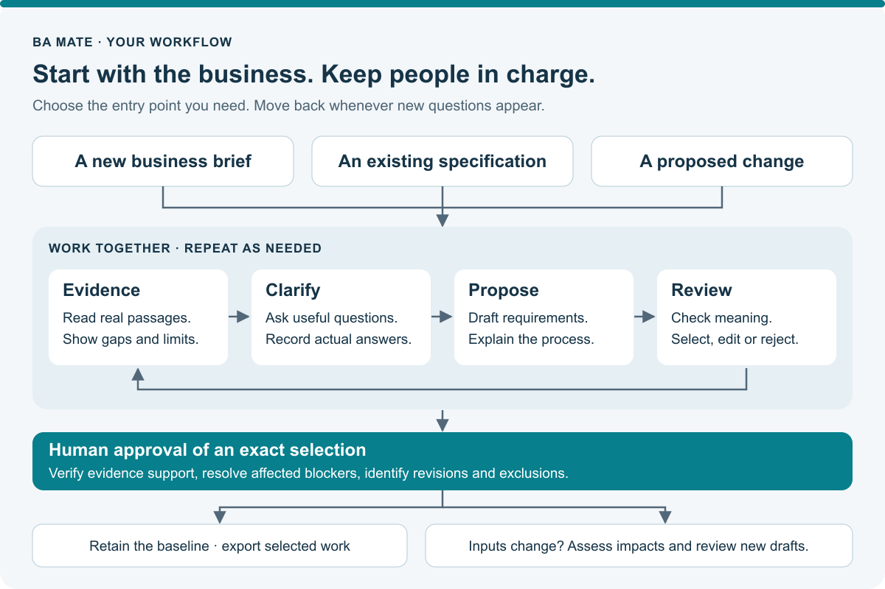

# BA Mate · User Guide

**Turn a business brief into requirements you can explain, review and keep up to date.**

BA Mate adds a Business Analysis workflow to your existing AI environment. You bring the business context, source material and human decisions. It helps you ask useful questions, propose requirements, model processes and prepare documents with links back to the evidence.

This guide is for BAs, product owners, students, researchers and stakeholders trying **v1.0.5 research beta**. You do not need to learn the record schema or use terminal commands to begin.

## Begin here

Start with **Guide 1**. The editable Word set separates everyday BA work from optional beta testing. You do not need to read all three documents before starting.

| Document | Use it for | Length |
|---|---|---|
| **[1 Getting Started](BA-Mate-01-Getting-Started-v1.0.5.docx)** | Install the skill, try your first conversation, save and resume | 4 pages |
| **[2 Workflow and Prompts](BA-Mate-02-Everyday-Workflow-v1.0.5.docx)** | Choose a mode, copy a prompt, follow a fictional example, review, approve and handle change | 5 pages |
| **[3 Testing and Feedback](BA-Mate-03-Testing-and-Feedback-v1.0.5.docx)** | Optional fictional tests, a run record, participant ratings, written feedback and separate reviewer notes | 6 pages |

The feedback pack has labelled rating checkboxes, editable Word answer areas and ruled writing space. You may complete it digitally or print the relevant pages.

The set uses the supplied BA Mate logo, the application's **Google Sans Flex** font, embedded diagrams, native headings and page numbers. The font is embedded; licensed font files are also in [fonts](fonts/README.md) for viewers that do not honour embedded fonts. The previous long Word edition is superseded by this set.

The Markdown reading path remains available below. Word sources and publishing notes are in [PUBLISHING.md](PUBLISHING.md).

1. [Install and start your first conversation](01-start-here.md).
2. [Choose a mode and copy a useful prompt](02-modes-and-prompts.md).
3. [Follow a complete fictional example](03-worked-example.md).

When you are ready to keep or share the work:

- [Review, approve and handle changes](04-review-and-change.md).
- [Save, resume and export](05-save-and-resume.md).
- [Solve problems and send useful feedback](06-help-and-feedback.md).

## How the work fits together



Start wherever your project needs help. An existing specification can go straight to review; a change can start with impact analysis. Return to evidence or clarification whenever a new uncertainty appears. You do not have to complete every mode for every task.

## One skill, several modes

You can usually write:

```text
Use BA Mate to clarify this brief. Separate confirmed facts from assumptions,
ask the questions that matter most, and keep the result as a draft.
```

Names such as **Clarify**, **Draft** and **Review** describe the work you want. They are not eleven separate installations or universal slash commands. Your host may offer a skill picker, `$ba-mate` or `/ba-mate`; the [starting page](01-start-here.md) explains the differences.

## What a good result looks like

A useful BA Mate result shows what evidence was used, what remains unknown, what the AI proposed, what people actually decided and which revisions were approved. It should leave you able to explain *why* a requirement exists.

Accepting an AI proposal creates a **draft**. Checking its source establishes whether that source supports its meaning. Approving selected revisions is a separate human decision. The [review guide](04-review-and-change.md) explains this distinction with a diagram.

## About this beta

The packages target Codex, Claude Code, Cursor, Antigravity and Gemini CLI. Actual behaviour has different levels of evidence on each host; **no host is fully qualified across all journeys**. Read the [current compatibility record](../COMPATIBILITY.md) before choosing a host. A successful installation is not a promise that every model follows the workflow correctly.

Start with fictional material and share what worked or failed. Public testing explores usability and portability; the skill's effectiveness has not been established by these checks. The framework is **F4-draft.1**, the package is **1.0.5**, and the record schema is **1**.

---

**Next:** [Install and start →](01-start-here.md)
