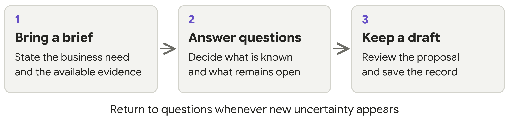

# BA Mate Getting Started

Guide 1 of 3 · For your first session · v1.0.5 research beta

BA Mate adds a business analysis workflow to your existing AI tool. It helps organise evidence, questions, requirements and review. You supply the business context and decisions.

## What you will do

Install one skill, try a fictional brief and leave with a small draft plus a record you can resume. No programming or terminal commands are needed for the folder-copy installation.

## Start small

Use a fictional project first. Ask for open questions or one requirement with acceptance criteria: observable checks for whether it has been met. You can begin with an existing specification or a change request.

**You do not need to learn eleven commands.** Start, Clarify, Draft and Review are names for types of work. Select the single BA Mate skill and describe what you want in ordinary language. Shortcuts such as /ba-mate differ between tools.

## Know the boundary

An AI proposal is not a business decision. Selecting it creates a draft; checking the source establishes whether it supports the meaning; an authorised person approves identified revisions separately.

This is a public research beta. Host behaviour is only partly tested, and research effectiveness is not established. Begin with material you are allowed to share with your chosen AI provider.

<!-- page -->

## 1 Install and select BA Mate

### Prepare your project

Download and extract BA-MATE-SKILL from the project repository. Check that its VERSION file says 1.0.5. Create a separate practice folder, such as pottery-practice. Open that folder in your AI tool; this is where your BA work will belong.

### Copy the complete skill

In the download, find skills/ba-mate. Copy the whole ba-mate folder, including SKILL.md, references, assets and scripts, into the location for your tool below. Create the parent folders if needed.

| AI tool | Copy the skill into | Select the skill with |
|---|---|---|
| Codex | .agents/skills/ba-mate/ | Skill picker; $ba-mate in CLI or IDE |
| Claude Code | .claude/skills/ba-mate/ | /ba-mate followed by your request |
| Cursor | .cursor/skills/ba-mate/ | /ba-mate or attach it with @ |
| Antigravity | .agents/skills/ba-mate/ | Ask to use BA Mate; available controls vary |
| Gemini CLI | .gemini/skills/ba-mate/ | Ask to use ba-mate; /skills list shows discovery |

For example, Cursor should find pottery-practice/.cursor/skills/ba-mate/SKILL.md, with the resource folders beside it. Show hidden folders in your file browser if the dot-prefixed folders are invisible. Codex and Antigravity share one location; keep one copy there.

### Confirm that the skill is available

Start a fresh chat in your practice project. Select BA Mate using your tool’s entry point, then describe the task in ordinary language. Where your tool exposes file reads, look for the installed SKILL.md being loaded. A plausible answer alone does not prove activation.

The shortcuts in the table select the same skill. They are not eleven separate mode commands. Downloading the repository alone does not install it, and installation does not provide an AI account or subscription.

**Updating or removing it.** Preserve an existing installation before replacing it. To uninstall, remove only the installed ba-mate skill folder; keep your project records. The repository installation guide covers plugin and global alternatives.

<!-- page -->

## 2 Try your first conversation

Select BA Mate, then copy the prompt below into your chat. It is an ordinary request to the AI tool, not an installation command.

> Use BA Mate. This is a fictional practice project for a pottery studio. Customers reserve workshop seats. Unpaid reservations should be released quickly, but we have not decided the deadline or when it starts. Start with scope and clarification. Separate facts, assumptions and unknowns. Ask the most important questions first. Do not invent a deadline, payment method or notification policy. Keep the work as a draft.

### Recognise a useful first response

Expect questions about the release deadline, its starting event, payment confirmation, exceptions and who decides these matters. Questions may appear in the tool’s question controls or as a numbered list in the conversation.

A useful response distinguishes information you supplied from unknown information. It should not invent numbers or stakeholder answers. If a source cannot be read fully, it should explain what was unreadable or omitted.

### Answer only what you know

For practice, you can explicitly supply fictional decisions. In real BA work, record actual stakeholder answers. If an answer is unknown, say so and identify the person who must decide. Continue with unaffected work while an affected requirement remains blocked.

> Record the deadline as unknown and the studio owner as its decision owner. Show which draft work can continue and which approval is blocked by this missing decision.

### Ask for a small draft

Use this request after supplying the necessary answers. If you want ready-made fictional decisions for practice, use the pottery example in Guide 2. A draft should not silently fill gaps in the business rules.

> Use BA Mate to draft one requirement and observable acceptance criteria from the answers I supplied. Show the supporting source passages and any remaining assumptions. Keep the original proposal, my edits and my selection or rejection decisions.

**Check before continuing.** Can you explain what the requirement means, where it came from and what still needs a decision? If not, ask for clarification or correction. Selecting a proposal does not approve it.

<!-- page -->

## 3 Save your work and resume later

Before ending, ask BA Mate to save the current state. Check the saved location or retain the supplied record yourself. Do not rely on memory of an earlier chat.

> Save the draft work and session record in this project. Show where it was saved, which checks actually ran, the open questions and the next useful action. If saving is unavailable, give me a complete session ledger that I can save myself.

### Confirm the saved record

With suitable file access, working records belong in ba-mate-workspace inside your BA project. Ask which files were actually saved and which checks completed. The optional helper checks record structure; people still check meaning and business authority.

Without Python or file access, save the supplied session ledger yourself. This portable record retains the brief, sources, answers, proposals, edits, draft revisions, open issues and approval scope. Automated checks and saving have not run unless the tool actually completed them.

### Resume from the record

Open the same project and supply the saved records, or paste the ledger into a new chat.

> Use BA Mate to resume from these records. Show the current draft, open decisions, approval scope if any, and the next useful action. Tell me if history or supporting evidence is missing.

### If something goes wrong

| What you see | What to do |
|---|---|
| BA Mate is missing | Check the project folder and SKILL.md location; reopen the chat and select the skill explicitly. |
| The AI invents a rule or number | Reject that proposal, record the unknown decision and ask the responsible person. |
| A file or export fails | Keep the last saved copy. Request readable text or a ledger and record the limitation. |

**Next:** use Guide 2 for mode prompts, the full example, review, approval and change. Use Guide 3 only for optional testing and feedback.

[Project and downloads](https://github.com/NimnadaUGC/BA-MATE-SKILL) · [Installation options](https://github.com/NimnadaUGC/BA-MATE-SKILL/blob/main/docs/INSTALLATION.md) · [Dated compatibility evidence](https://github.com/NimnadaUGC/BA-MATE-SKILL/blob/main/docs/COMPATIBILITY.md)
