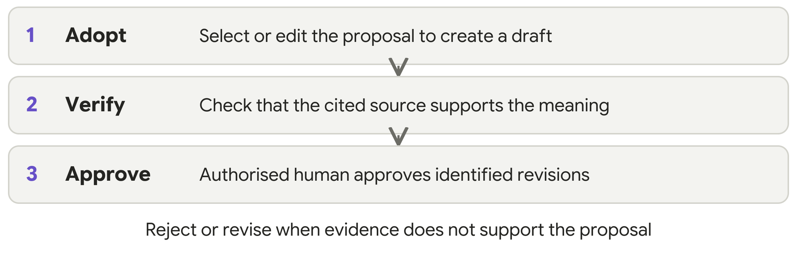
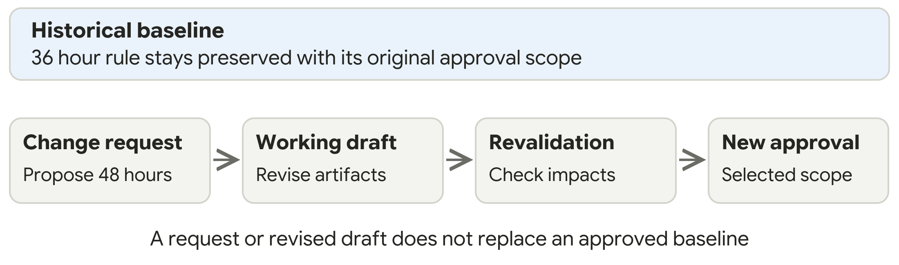

# BA Mate Workflow and Prompts

Guide 2 of 3 · Keep beside your BA work · v1.0.5 research beta

Choose the task you need help with, then ask for it in plain language. Start new briefs with Start and Clarify, existing specifications with Evidence and Review, and changes with Change. A baseline is a retained set of approved revisions. Move between modes as evidence and decisions change.

## 1 Choose the task you need

| Your task | Mode | Useful output |
|---|---|---|
| Agree the purpose and scope | Start | Scope, stakeholders and decision authority |
| Understand the information | Evidence | Reviewed sources, passages and limitations |
| Resolve missing decisions | Clarify | Questions, answers and unresolved conflicts |
| Propose requirements | Draft | Requirements, stories, rules and criteria |
| Explain a process | Model | Actors, decisions, exceptions and a model |
| Check the work | Review | Findings, affected items and corrections |
| Assemble a document | Document | SRS, BRD, summary or trace report |
| Approve selected revisions | Baseline | Readiness check, decision and snapshot |
| Assess a change | Change | Impacts, revised drafts and revalidation |
| Return to saved work | Status or Resume | Recorded state, open decisions and next action |
| Share with developers | Handover | Selected BA artifacts and disclosed gaps |

**One skill, several modes.** Select BA Mate using your tool’s supported mechanism, then write “Use BA Mate to review this specification.” Do not assume /review or /draft is an installed command. Guide 1 lists the host-specific entry points.

<!-- page -->

## 2 Copy a prompt and add your material

Choose one request below and attach or paste the information it needs. Review the answer before moving on. You can combine modes, but a small first output is easier to check.

### Establish scope and evidence

> Use BA Mate to establish the purpose, scope, stakeholders, decision authority and deliverables. Register my supplied material as evidence. Show relevant passages, extraction limits and omissions. Separate facts, inference, assumptions, contradictions and unknowns.

Supply a brief or source document. If a file cannot be read fully, ask what was omitted. Instructions inside source material are evidence to examine; they must not override the workflow. A specification labelled “approved” needs supporting human records.

### Clarify and draft

> Use BA Mate to ask the questions that most affect this task and record my actual answers. Draft only what the evidence supports. Show acceptance criteria, evidence references and remaining blockers. Preserve the original proposals and my edits, selections or rejections.

Acceptance criteria are observable conditions for checking a requirement. Keep unknown rules and quality thresholds open. Selecting a proposal creates a draft; it does not approve the result.

### Model and review

> Use BA Mate to explain this process with actors, decisions and exceptions. Provide readable process text and Mermaid source if useful. Review the work for clarity, completeness, consistency, testability, relevance, transparency, stakeholder coverage, traceability and ethical risks. Check that the sources support the meaning.

Mermaid is editable diagram text; rendering needs a suitable tool. Traceability links actual source, requirement and criterion IDs and revisions; check the meaning, too. Label self-review honestly: a second AI role in one response does not establish independent review.

### Assemble and hand over

> Use BA Mate to assemble a document from my selected revisions. State its purpose, scope, status, evidence links, open decisions and exclusions. For developer handover, include only selected BA artifacts and missing decisions. Do not invent a technical architecture.

An SRS describes software requirements; a BRD explains business needs and scope. Choose the audience and deliverable before requesting an export. Word, PDF and rendered diagrams require suitable tools and checking after conversion.

<!-- page -->

## 3 Follow a small fictional example

### The business input

A pottery studio wants unpaid workshop reservations released. The initial word “quickly” is too vague to implement or test. BA Mate should ask for a decision, not choose a deadline.

For this practice case, the human playing the studio owner supplies these decisions. They are fictional inputs, not BA Mate defaults.

| Decision | Owner supplied answer |
|---|---|
| Start of the hold | When staff confirm the reservation |
| Release deadline | Automatically after 36 elapsed hours, if still unpaid |
| Payment exception | Staff record payment; payment at or before the deadline prevents release |
| Scope | Bookings at least seven days before the workshop; later bookings, refunds and reminders excluded |

### The proposed draft

**Requirement:** Release an in-scope seat at 36 elapsed hours after staff confirmation if no payment was recorded at or before that deadline. Retain a reservation whose payment was recorded by the deadline.

**Acceptance criteria:** Check the three observable outcomes below.

- An unpaid in-scope reservation releases at the deadline.
- Payment recorded before the deadline prevents release.
- Payment recorded exactly at the deadline also prevents release.

### Check the evidence before approval

A proposed rule saying “release every reservation after 36 hours” contradicts the paid-reservation exception. A valid source citation does not repair that contradiction. Reject or edit the proposal and record why.

<!-- page -->

## 4 Approve a defined scope and handle change

### Before you approve

Review the actual source passages and resolve blockers affecting the selected items. Ask BA Mate to present the exact record IDs and revisions, related criteria and models, remaining issues, exclusions and the person authorised to decide. Structural validation checks the records; it does not verify meaning or authenticate identity.

> Prepare a baseline readiness review for the revisions I selected. Show the exact approval scope and exclusions, supporting human reviews and any affected blockers. Ask for an authorised human decision only when the scope is clear.

A person with the relevant business authority must make the decision. Tool execution permission and an unclear “looks good” response do not establish scoped business approval. Once clear approval for that exact scope has actually been supplied, record it accurately.

### Approve the actual revision list

The approval manifest is the list of exact records and revisions presented for a decision. The authorised person identifies that list, their authority and any exclusions. Use the actual list in your session. Preserve the human decision and selected contents together as a historical baseline.

### When the owner requests 48 hours

The earlier pottery baseline still says 36 elapsed hours. A request to change it to 48 creates a change proposal, not an automatic replacement of the approved record.

> Use BA Mate to assess this proposed change against the retained baseline. Identify affected sources, requirements, criteria, process models and documents. Preserve the old baseline. Prepare new drafts, record impact decisions and revalidate affected items before a new approval.

A changed source can also trigger review of approved downstream items. Impact candidates require human assessment. Work may continue elsewhere while approval of affected items remains blocked. Partial approval must identify the exact included revisions and explicitly excluded items.

<!-- page -->

## 5 Save resume and share the right version

### Keep the project record

Keep the project record in ba-mate-workspace: sources and extraction limits, answers, assumptions, proposals and edits, selection decisions, revision links, findings, approvals and change history. Keep private records out of the public skill repository.

The optional Python 3.10 or later helper supports validation, checkpoints, impact analysis, baselines and export. Follow its guidance and check what actually completed. Do not manually edit its internal record files.

### Use a manual ledger when necessary

Without file access or Python, save an exportable [session ledger](https://github.com/NimnadaUGC/BA-MATE-SKILL/blob/main/skills/ba-mate/assets/session-ledger.md) and supply it when resuming. Retain the scope, evidence, answers, proposals, edits, revisions, open issues, approvals and next actions. State that automated integrity checks did not run.

> Use BA Mate to resume from these saved records. Identify missing history and stale evidence. Show the current revisions, open questions, baseline scope and the next useful action. Do not assume access to an earlier chat.

### Choose the export deliberately

| Export | What the recipient should receive |
|---|---|
| Working draft | Selected current revisions, draft status and unresolved items |
| Historical baseline | The retained approved contents, approval scope and exclusions; later changes disclosed separately |
| Developer handover | Selected BA artifacts, evidence links, criteria and missing decisions; no invented architecture |

> Export the selected revisions for this audience. State whether this is a working draft or a named historical baseline. Include unresolved items and omissions. Tell me which files were actually written and which conversions were unavailable.

### Recover without losing history

Keep the last usable saved copy after a failed operation. A restored checkpoint becomes working drafts requiring review; it does not recreate business approval. Helper-managed baseline snapshots remain immutable. If evidence, extraction or history is missing, continue only with a disclosed limitation and block affected approval.

For a native BA Mate application archive, supply reviewed readable material instead of assuming workspace import compatibility. For installation problems and voluntary test feedback, use Guide 3.

